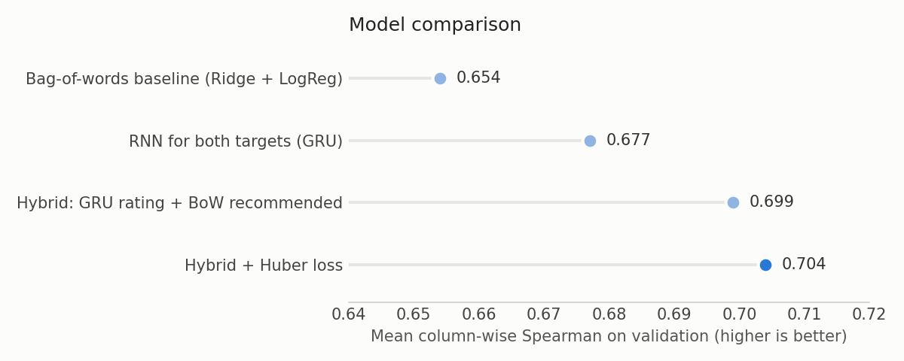
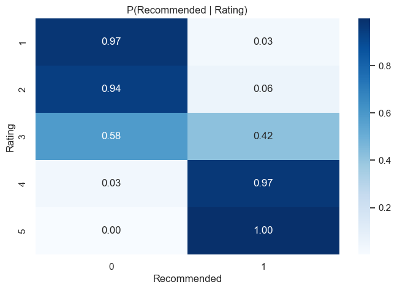

# review-rating-nlp

Predicting a customer's **star rating (1–5)** and **whether they recommend the product** from the
text of ~14k clothing reviews. The best model, a GRU network for the rating combined with a
bag-of-words classifier for the recommendation, reaches a **mean Spearman correlation of 0.704**,
compared with **0.654** for the classical baseline.



*Final project of the DAN.IT Data Science course (in-class Kaggle competition).*

## Results

Validation set: 2,819 reviews (20% hold-out). Metric: mean column-wise Spearman correlation
(the competition metric), computed with Kaggle-valid outputs (integer ratings, 0/1 labels).

| Model | Rating ρ | Recommended ρ | **Mean ρ** |
|---|---|---|---|
| Bag-of-words baseline: Ridge (rating) + Logistic Regression (recommended) | 0.608 | 0.700 | 0.654 |
| GRU network for both targets | 0.694 | 0.660 | 0.677 |
| Hybrid: GRU (rating) + bag-of-words LogReg (recommended) | 0.696 | 0.701 | 0.699 |
| **Hybrid + Huber loss for the rating network** | **0.707** | **0.701** | **0.704** |

The two model families are good at different targets. The sequence model reads word order
better for the fine-grained 1–5 rating, while the linear bag-of-words model is already strong
and more stable for the binary recommendation, so the hybrid takes the better model for each target.

## Data insight



The targets are strongly related (Spearman 0.69). Ratings of 4–5 are almost always
recommended and 1–2 almost never, so the hard cases are the **3-star reviews (42% recommended)**.
The data is also imbalanced: 56% of reviews are 5-star and 82% recommend the product.
Missing review text turned out to be informative (reviews without text have higher ratings),
so missingness flags are used as features.

## Approach

- **EDA:** target distributions, target correlation, review length vs rating, informative missingness.
- **Baseline:** cleaned text → unigram+bigram `CountVectorizer` (30k features), plus one-hot
  categories and scaled numeric features (age, positive-feedback count) → Ridge / class-balanced Logistic Regression.
- **Neural model:** tokenized and padded reviews → Embedding (64) → GRU (64) → Dense, in TensorFlow/Keras with early stopping.
- **Hybrid and tuning:** best model per target; Huber loss for the rating network (robust to the
  skewed rating distribution); compared bag-of-words and TF-IDF features; tuned the decision threshold for the recommendation.
- **Output format:** compared continuous vs rounded ratings and probabilities vs hard labels on
  the competition metric before choosing the submission format.

## Repository structure

```
notebooks/
  01_eda.ipynb                        exploratory data analysis
  02_classical_nlp_bow_baseline.ipynb bag-of-words baseline
  03_rnn_tensorflow.ipynb             GRU models for both targets
  04_hybrid_model.ipynb               hybrid GRU + bag-of-words
  05_hybrid_improvements.ipynb        Huber loss, TF-IDF, threshold tuning
results/                              figures used in this README
presentation/                         final project slides
data/README.md                        how to get the data
```

## How to run

```bash
git clone https://github.com/dariaproniakova/review-rating-nlp.git
cd review-rating-nlp
pip install -r requirements.txt
# put train.csv and test.csv in data/rawdata/ (see data/README.md)
jupyter lab notebooks/
```

## What I learned / limitations

- A simple linear model on n-grams is a strong baseline for text classification. The neural
  network only clearly helped on the more nuanced target.
- The evaluation metric shapes the output format: hard labels scored higher than probabilities on
  Spearman here, which I would not have guessed without testing it.
- Scores come from a single validation split. Cross-validation, and a pretrained transformer
  (e.g. DistilBERT), are the natural next steps.

## License

Code: MIT. The dataset is not included in this repository.
